# 🏆 CertifIA • AI Cloud Exam Prep & Cognitive Engine

<div align="center">

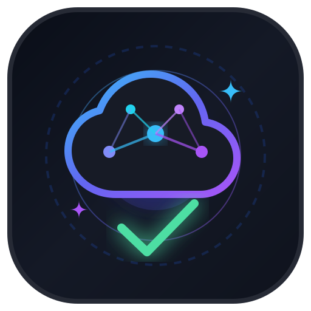

### *Plateforme intelligente de préparation certifiante et de télémétrie cognitive pour examens Cloud & IA*
### *Intelligent Certification Prep & Cognitive Telemetry Platform for Cloud & AI Exams*

[](CHANGELOG.md)
[](src/i18n/config.ts)
[](src/i18n/verifyI18nParity.ts)
[](public/manifest.webmanifest)
[](src/lib/srsAlgorithm.ts)
[](src/context/ThemeContext.tsx)
[](src/data/certificationsData.ts)
[](src/data/flashcardsData.ts)

</div>

---

## 📱 Logo PWA Officiel & Installation sur Écran d'Accueil

<div align="center">
  <table>
    <tr>
      <td align="center" width="160">
        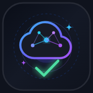
        <br />
        <sub><strong>Icône PWA Officielle</strong><br /><code>192×192</code> • <code>512×512</code> • Maskable</sub>
      </td>
      <td align="left">
        <ul>
          <li>📲 <strong>Bouton « Installer l’application »</strong> : accessible depuis l’en-tête (menu Compte), la barre latérale et les paramètres système pour ajouter CertifIA en 1 clic sur mobile (iOS/Android) ou bureau (Chrome/Edge/macOS).</li>
          <li>🖼️ <strong>Pack d’Icônes PWA Natif</strong> : génération dédiée <code>pwa-192x192.png</code>, <code>pwa-512x512.png</code>, <code>pwa-maskable-512x512.png</code> et <code>apple-touch-icon.png</code> (<code>180×180</code>) pour un rendu natif sur l’écran d’accueil sans barre de navigateur.</li>
          <li>🔄 <strong>Mises à Jour Automatiques en Arrière-Plan</strong> : Service Worker autonome (<code>certifai-cache-v2.9.0</code>) avec détection <code>updatefound</code> et activation silencieuse (<code>SKIP_WAITING</code>) toutes les 3 minutes.</li>
        </ul>
      </td>
    </tr>
  </table>
</div>

---

## ✨ Architecture UX/UI, Gouvernance & Accompagnement (v2.9.0)

| Module | Composant Clé | Fonctionnalités Implémentées |
| :--- | :--- | :--- |
| 🍔 **Menu Hamburger Catégorisé** | `CategorizedHamburgerMenu.tsx` | Regroupement de toutes les vues et outils en **6 catégories** (*Accueil, Certifications, Apprentissage, Progression, Assistant IA, Plus*) avec recherche instantanée et raccourci `Ctrl+M`. |
| 🧭 **Barre Supérieure Allégée** | `Header.tsx` | Organisation épurée en **3 zones** (Navigation + Breadcrumb, Recherche `Ctrl+K`, Commandes & Menu Compte unifié) pour zéro encombrement visuel de `360px` à `1440px+`. |
| ⚙️ **Paramètres Système & Auto-Update** | `SystemSettingsModal.tsx` | Affiche la **Date de sortie** (`16 Novembre 2026`), la **Dernière vérification**, le bouton **« Vérifier les mises à jour »**, le bouton **« Forcer la mise à jour »** et le commutateur de mises à jour automatiques. |
| 💡 **Onboarding Contextuel & Infobulles** | `ScreenGuideBanner.tsx`, `InfoTooltip.tsx` | Bandeau explicatif rétractable en 3 étapes + infobulles d’aide (?) intégrées sur **chacun des 10 écrans** de l’application, synchronisés avec le mode Guide Novice. |
| ⚖️ **Onboarding & Mentions Légales** | `LegalOnboardingModal.tsx` | Acceptation obligatoire à la première ouverture précisant explicitement que **l’éditeur et le concepteur ne sont pas responsables des données, questions ou réponses fournies**. |
| 🛡️ **Audit du contenu (Admin)** | `ContentAuditWorkspace.tsx`, `server.ts` | Espace réservé aux administrateurs vérifiés pour auditer les **2 862 contenus**, vérifier les sources officielles, lancer des contrôles déterministes / IA (`gemini-4-hydrogen`) et valider humainement avant publication ([architecture](AUDIT_CONTENT_ARCHITECTURE.md)). |

---

## 📸 Galerie Complète des Captures d'Écran Réelles de l'Application (v2.9.0)

> **Documentation visuelle actualisée :** Toutes les captures d'écran ci-dessous illustrent les écrans réels de CertifIA avec la barre latérale rétractable, l'en-tête allégé, le menu hamburger catégorisé, l'onboarding contextuel et les infobulles sur chaque écran, le cockpit quotidien, le moteur de parcours, les QCM scénarisés, les flashcards SM-2, les examens blancs et la visite guidée automatique.

---

### 1. 🏠 Cockpit Quotidien & Algorithme CertifIA (Session du Jour)

<div align="center">
  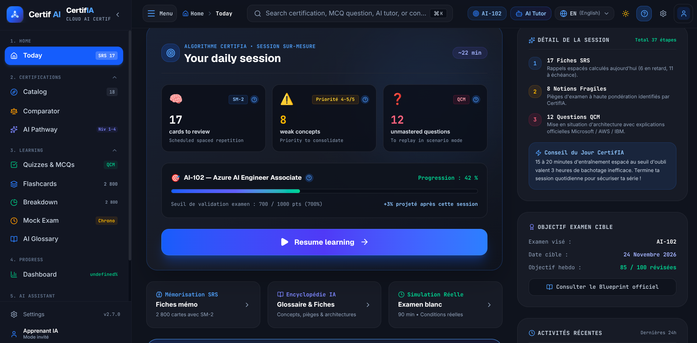
</div>

* **Session Quotidienne Dynamique** : Calculée en temps réel à partir de votre historique réel dans `src/lib/metricsEngine.ts` et `src/lib/srsAlgorithm.ts` (démarre strictement à `0` pour un nouvel apprenant) :
  * 🧠 **File de révision SM-2 / FSRS** : Fiches dues à échéance (`nextReviewDate <= today`) complétées par des cartes de découverte.
  * ⚠️ **Notions fragiles** : Cartes identifiées dynamiquement selon vos évaluations réelles (*À revoir* / *Difficile*, taux de réussite < 70 %).
  * ❓ **Questions QCM non maîtrisées** : Filtrées dynamiquement d'après vos tentatives enregistrées.
* **Trajectoire Examen & Progression** : Jauge temps réel calculée depuis vos scores d'examens blancs, quiz et rétention SRS (dépourvue de toute valeur fictive).
* **Accès Rapide aux 3 Piliers d'Étude** : Mémorisation SRS (2 800 cartes), Encyclopédie IA (Glossaire) et Simulation Réelle (90 min).
* **Détail de Session & Objectif Cible** : Date cible d'examen et suivi hebdomadaire synchronisés en LocalStorage et Cloud Firestore.

---

### 2. ✨ Moteur d'Orientation & Parcours IA Personnalisé (Niveaux 1 à 4)

<div align="center">
  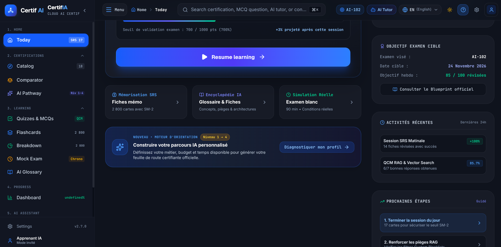
</div>

* **Diagnostic Structuré en 4 Paliers** :
  1. *Niveau 1 : Fondamentaux Cloud & IA* (Azure AI-900, AWS AIF-C01).
  2. *Niveau 2 : IA Générative Spécialisée* (AWS Bedrock, IBM watsonx Studio).
  3. *Niveau 3 : Cloud AI Engineer Associate* (Azure AI-102 Associate).
  4. *Niveau 4 : Machine Learning & MLOps Avancé* (Google Cloud PMLE, AWS MLS-C01).
* **Feuille de Route Personnalisée** : Générée selon votre métier (Développeur, Data Scientist, Solution Architect), votre budget et votre temps disponible hebdomadaire.
* **Prochaines Étapes Guidées** : Liste d'actions concrètes numérotées pour sécuriser votre certification sans dispersion.

---

### 3. 🎯 Suivi des Objectifs d'Examen & Activités Récentes

<div align="center">
  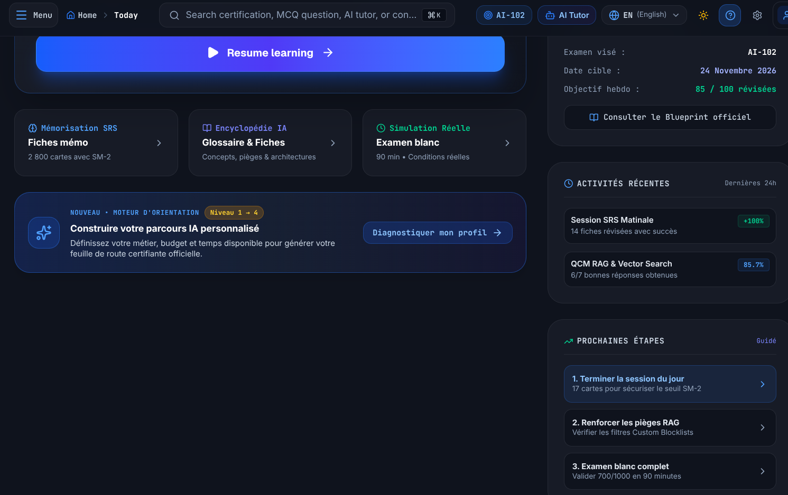
</div>

* **Suivi de l'Examen Visé (AI-102)** : Date cible fixée, objectif de 85 / 100 révisées par semaine, consultation directe du blueprint officiel en un clic.
* **Historique des Activités des Dernières 24h** : Télémétrie en temps réel des sessions matinales SRS (+100%) et des QCM RAG & Vector Search (85.7% de réussite).
* **Prochaines Étapes Priorisées** : Consignes pas-à-pas pour terminer la session du jour, renforcer les pièges RAG (Custom Blocklists) et planifier un examen blanc complet.

---

### 4. 🧭 Catalogue Officiel des 6 Certifications Cloud & IA

<div align="center">
  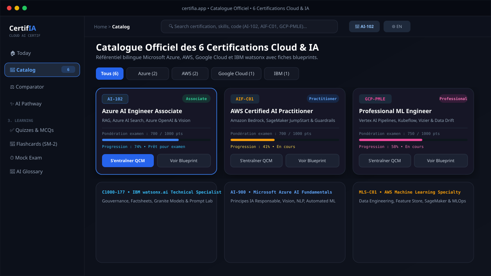
</div>

* **Couverture Multi-Fournisseurs (2 800 fiches réparties sur 27 domaines officiels)** :
  * 🔷 **Microsoft Azure** : `AI-102` (Azure AI Engineer Associate — 500 fiches), `AI-900` (Azure AI Fundamentals — 500 fiches).
  * 🟧 **Amazon Web Services (AWS)** : `AIF-C01` (Certified AI Practitioner — 500 fiches), `MLS-C01` (Machine Learning Specialty — 400 fiches).
  * 🟥 **Google Cloud Platform (GCP)** : `GCP-PMLE` (Professional Machine Learning Engineer — 500 fiches).
  * 🟦 **IBM** : `C1000-177` (IBM watsonx.ai Technical Specialist — 400 fiches).
* **Filtres Avancés & Fiches Blueprints** : Recherche instantanée par code, niveau (Fondamental, Associate, Specialty, Professional) et accès au comparateur côte à côte.

---

### 5. ✅ Moteur d'Entraînement QCM & Analyse des Pièges d'Examen

<div align="center">
  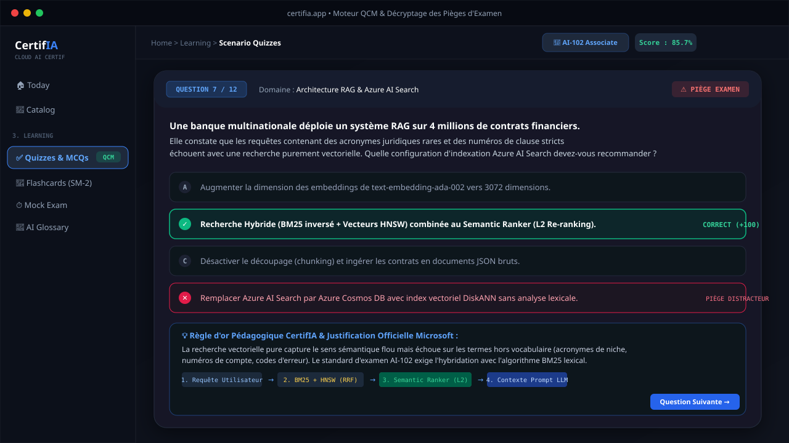
</div>

* **Mise en Situation Réelle d'Architecture** : Scénarios d'entreprise réalistes (banque, santé, e-commerce, industrie).
* **Décryptage Approfondi des Distracteurs** : Chaque proposition fausse est expliquée en détail pour vous apprendre à déceler les pièges subtils des éditeurs d'examen.
* **Schémas de Flux Techniques (ASCII / Visuels)** : Visualisation du pipeline d'architecture (ex. *Requête ➔ BM25 + HNSW (RRF) ➔ Semantic Ranker L2 ➔ Prompt LLM*).
* **Règle d'or Pédagogique CertifIA** : Synthèse infaillible à mémoriser pour réussir l'examen officiel.

---

### 6. 🎴 Fiches Mémo & Répétition Espacée SM-2 (2 800 Cartes)

<div align="center">
  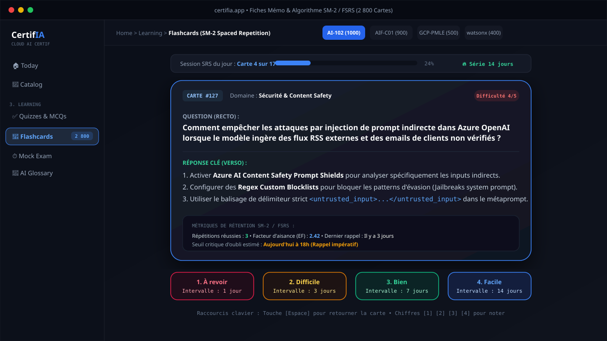
</div>

* **Algorithme Scientifique SuperMemo-2 (SM-2) / FSRS** : Calcul automatique du seuil critique d'oubli pour réviser chaque concept au moment mathématique idéal.
* **Échelle d'Évaluation à 4 Boutons** :
  * 🔴 **1. À revoir (1 jour)** : Échec de rappel, le concept est réinjecté sous 24h.
  * 🟠 **2. Difficile (3 jours)** : Rappel laborieux avec hésitation.
  * 🟢 **3. Bien (7 jours)** : Rappel maîtrisé, facteur d'aisance consolidé.
  * 🔵 **4. Facile (14 jours)** : Ancrage profond en mémoire à long terme.
* **Métrique de Rétention Complète** : Facteur d'aisance ($EF$), historique des répétitions et jauge de progression de la file du jour.
* **Contrôle Total au Clavier** : `Espace` pour retourner la carte (Recto/Verso), touches `1`, `2`, `3`, `4` pour noter.

---

### 7. ⏱️ Examens Blancs Chronométrés en Conditions Réelles

<div align="center">
  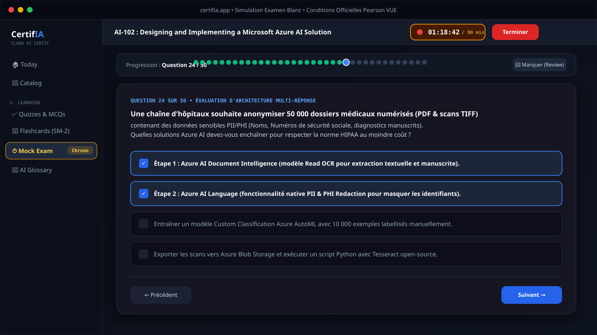
</div>

* **Conditions Réelles Pearson VUE** : Chronomètre officiel (90 à 120 minutes), épreuve complète de 50 à 65 questions, seuil éliminatoire officiel (**700 / 1 000 pts**).
* **Carte Interactive d'Avancement** : Grille visuelle de toutes les questions (répondues en vert, en cours en bleu, en attente en gris).
* **Fonctionnalité Marquer (Review Flag)** : Permet de marquer une question difficile pour y revenir avant de soumettre l'épreuve finale.
* **Rapport Final Détaillé** : Décomposition du score par domaine de compétences avec identification précise des lacunes.

---

### 8. 🤖 Tuteur Pédagogique IA Contextuel (Dialogue Socratique)

<div align="center">
  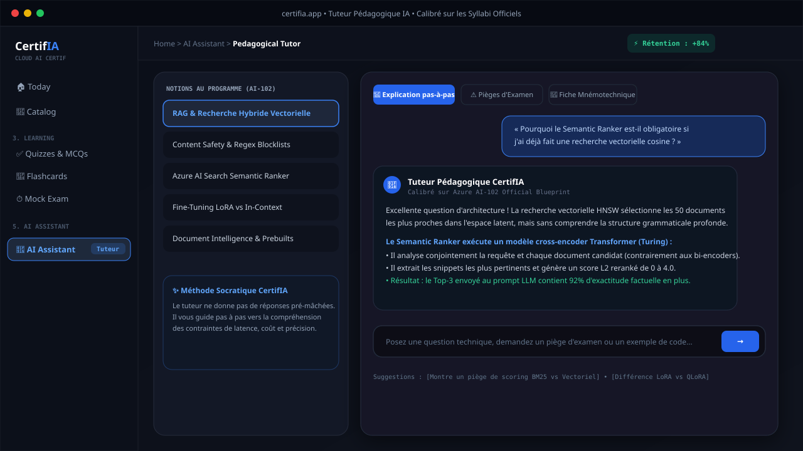
</div>

* **Approche Socratique d'Apprentissage** : Ne donne jamais la réponse brute sans réflexion : guide l'apprenant à travers les contraintes architecturales de latence, coût et précision.
* **Calibré sur les Syllabi Officiels** : Références précises aux documentations officielles (Microsoft Learn, AWS Docs, GCP Architecture Framework, IBM Cloud).
* **Double Format d'Utilisation** : Disponible sous forme d'écran dédié complet ou de tiroir coulissant contextuel (*Drawer*) accessible depuis n'importe quel QCM.
* **Suggestions de Questions Clés** : Amorces pré-calibrées pour explorer les pièges d'examen (BM25 vs Vectoriel, LoRA vs QLoRA, Private Endpoints).

---

### 9. 📊 Tableau de Bord & Télémétrie Cognitive

<div align="center">
  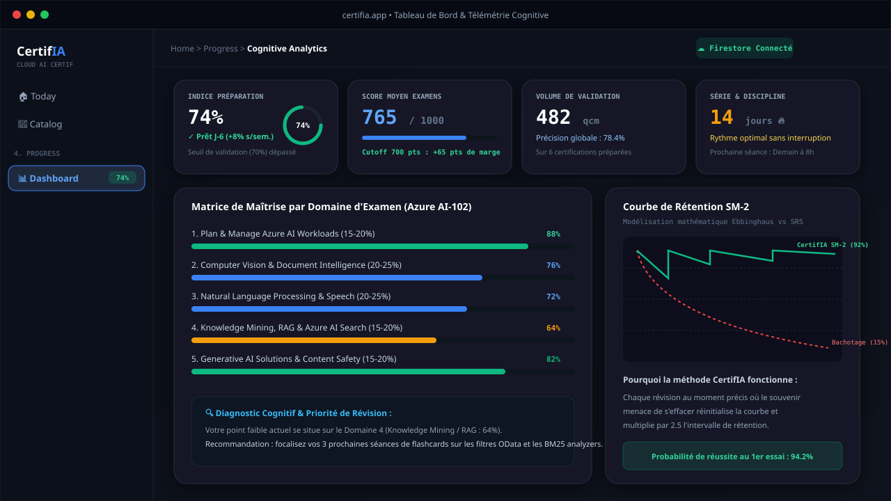
</div>

* **4 KPIs Cardinaux Calculés en Temps Réel (`src/lib/metricsEngine.ts`)** :
  * 🎯 **Indice de Préparation Globale** : Moyenne pondérée dynamique (Examens 45 %, Quiz 25 %, Rétention SRS 30 %), strictement à `0 %` sans activité.
  * 📈 **Score Moyen aux Examens** : Calculé depuis les tentatives réelles enregistrées dans `examAttempts` face au cutoff officiel (`700` ou `750 / 1000`).
  * 🔢 **Volume Traité & Précision** : Compteur réel de QCM et questions d'examens résolus et taux d'exactitude mesuré.
  * 🔥 **Série & Constance** : Calculée par jours calendaires locaux consécutifs (`computeStreakDays`), réinitialisable à `0`.
* **Matrice de Maîtrise par Domaine** : Visualisation granulaire calculée à partir des révisions par domaine de chaque certification.
* **Trajectoire Dynamique & Courbe Ebbinghaus vs SM-2** : Graphique de progression généré exclusivement à partir de vos examens blancs complétés (état vide explicite avant la première simulation).

---

### 10. 🧭 Onboarding Tour en Mode Découverte Automatique

<div align="center">
  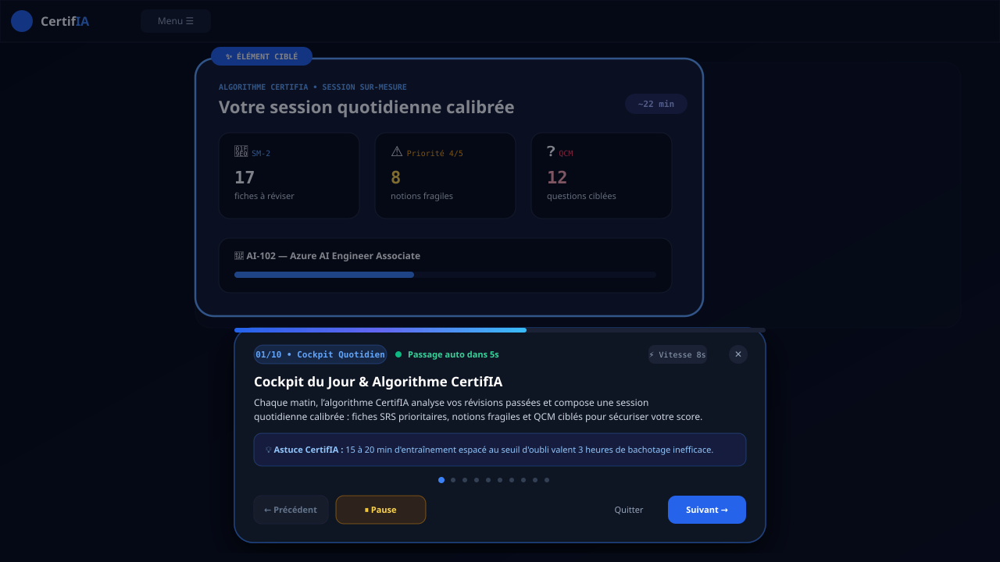
</div>

* **Parcours de Découverte 100% Automatique** : Présentation progressive des 10 modules clés de CertifIA sans intervention obligatoire de l'utilisateur.
* **Mise en Évidence Visuelle (Spotlight Cutout)** : Masque d'assombrissement avec anneau lumineux dynamique ciblant avec précision l'élément étudié (`data-tour`).
* **Commandes Explicites Complètes** :
  * ⏸️ **Pause / Continuer** : Fige la progression automatique pour lire attentivement les explications et astuces CertifIA.
  * ◀️ **Précédent** : Revient à l'étape précédente en réinitialisant le délai.
  * ⏹️ **Quitter** (ou touche `Échap`) : Ferme instantanément la visite guidée.
  * ⏭️ **Suivant** : Avance manuellement à l'étape suivante.
* **Régulateur de Vitesse** : Sélecteur de tempo automatique (Rapide 5s, Normal 8s, Détaillé 12s) avec barre de compte à rebours fluide.
* **Navigation Globale au Clavier** : `Espace` (Pause/Continuer), `←` (Précédent), `→` (Suivant), `Échap` (Quitter).

---

## 🌐 Bilinguisme Intégral Français / English (v2.9.0)

CertifIA garantit une expérience utilisateur **100% bilingue sans aucun texte résiduel** :

* 🔄 **Bascule Instantanée Sans Rechargement** : Changez de langue en un clic depuis le Header (`FR` / `EN`), le menu latéral ou le modal système sans perdre votre session active, votre chrono ou votre question en cours.
* 📦 **13 Namespaces i18next Embarqués Hors-Ligne** : `common`, `navigation`, `dashboard`, `certifications`, `learning`, `quizzes`, `flashcards`, `examinations`, `progress`, `assistant`, `settings`, `errors`, `notifications`.
* 🛡️ **Parité Programmatique Stricte 1:1** : Vérification automatisée via script dédié garantissant l'égalité parfaite des **1 012 clés bilingues** :
  ```bash
  npx tsx src/i18n/verifyI18nParity.ts
  # Output: ✅ 1012 French keys, 1012 English keys across 13 namespaces (0 missing, 0 extra)
  ```
* 🔢 **Formatage Régional Natif `Intl` Conforme** :
  * Dates : `15 mars 2026` (FR) vs `March 15, 2026` (EN).
  * Nombres : `1 250 000` (FR) vs `1,250,000` (EN).
  * Pourcentages : `85 %` (FR) vs `85%` (EN).
  * Devises : `165,00 $US` (FR) vs `$165.00` (EN).

---

## 🏛️ Les 5 Piliers Majeurs de l'Architecture Applicative

| Pilier | Écran Principal | Fonctionnalités Clés |
| :--- | :--- | :--- |
| **1. 🏠 ACCUEIL** | `TodayView.tsx` | Cockpit quotidien alimenté par `metricsEngine.ts`, file SRS SM-2 réelle, notions fragiles dynamiques, bouton reprise immédiate, bannière parcours 4 niveaux. |
| **2. 🧭 CERTIFICATIONS** | `CatalogueView.tsx` | 6 certifications officielles (Azure, AWS, GCP, IBM), filtres par fournisseur, fiches blueprints dynamiques, comparateur côte à côte. |
| **3. 🎓 APPRENTISSAGE** | `QuizView.tsx`, `FlashcardsView.tsx`, `ExamView.tsx`, `GlossaryView.tsx` | Hub pédagogique complet : QCM scénarisés persistés, 2 800 fiches mémo SM-2, examens blancs chronométrés, encyclopédie IA A-Z. |
| **4. 📊 PROGRESSION** | `AnalyticsView.tsx` | Télémétrie cognitive réelle (départ à `0`), matrice de maîtrise des domaines, courbe de trajectoire dynamique, historique et export RGPD. |
| **5. 🤖 ASSISTANT IA** | `AIAssistantView.tsx`, `AIAssistantDrawer.tsx` | Guide hors-ligne & Tuteur socratique contextuel basé sur les blueprints officiels et vos métriques SRS en direct. |

---

## ⌨️ Raccourcis Clavier Globaux

| Raccourci | Action |
| :--- | :--- |
| `Ctrl + K` / `Cmd + K` | Ouvrir la **Command Palette** (recherche globale et actions rapides) |
| `Ctrl + M` / `Cmd + M` | Ouvrir / Fermer le **Menu Hamburger Catégorisé** |
| `Espace` | Retourner la carte mémo active (Recto / Verso) • Mettre en pause ou continuer le Tour |
| `1` / `2` / `3` / `4` | Noter la carte active (*À revoir [1j]*, *Difficile [3j]*, *Bien [7j]*, *Facile [14j]*) |
| `←` / `→` | Naviguer entre les étapes du Onboarding Tour |
| `Échap` | Fermer n'importe quel panneau, tiroir, modal ou quitter la visite guidée |

---

## 🛠️ Stack Technique & Déploiement

* **Framework :** React 19 + TypeScript (Mode Strict)
* **Build Tool :** Vite 8
* **Styling :** Tailwind CSS v4 (Mode Sombre et Mode Clair)
* **Internationalisation :** i18next + react-i18next (13 namespaces, 1 012 clés 1:1)
* **Persistance & Données :** Cloud Firestore + LocalStorage haute fidélité
* **PWA & Offline :** Web App Manifest (`manifest.webmanifest`), icônes PNG `192×192` / `512×512` / `maskable` + Service Worker auto-update (`/sw.js`)
* **Icônes :** Lucide React

```bash
# Installation des dépendances
npm install

# Lancement en développement (Port 3000)
npm run dev

# Vérification de la parité bilingue (FR/EN)
npx tsx src/i18n/verifyI18nParity.ts

# Tests unitaires (moteur de métriques, SM-2, normalisation catalogue)
npm test

# Tests E2E & responsive (Playwright sur 320px–1920px + persistance & accessibilité)
npm run test:e2e

# Vérification TypeScript et compilation production
npm run lint
npm run build
```

---

## ⚖️ Mentions Légales & Avertissement

> **Clause d'exonération de responsabilité :**  
> L'éditeur et les créateurs de **CertifIA** ne sont en aucun cas responsables des données, informations, questions, propositions de réponses, explications, simulations ou synthèses fournies dans l'application, lesquelles restent purement indicatives. CertifIA est un projet indépendant d'entraînement cognitif personnel et n'est affilié à aucun des organismes certificateurs mentionnés (Microsoft, AWS, Google Cloud, IBM).
