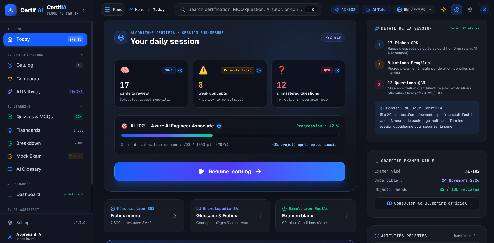
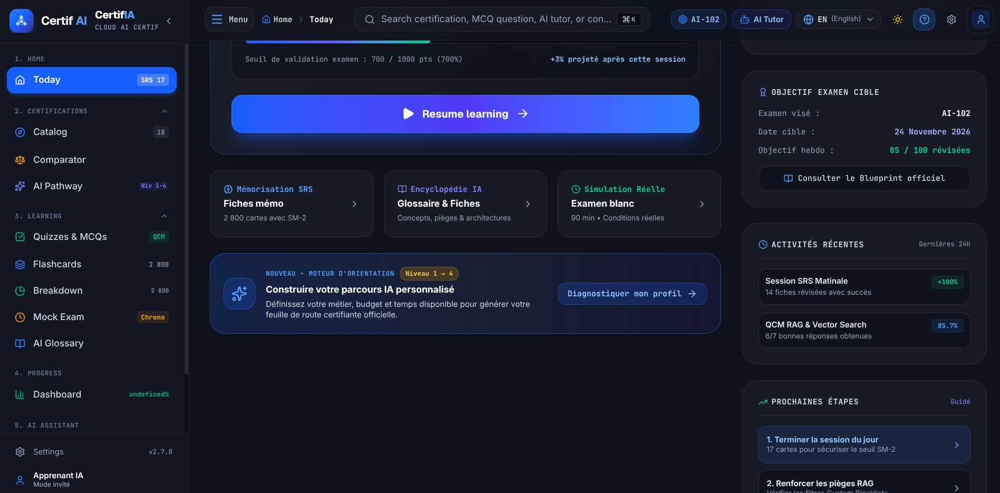
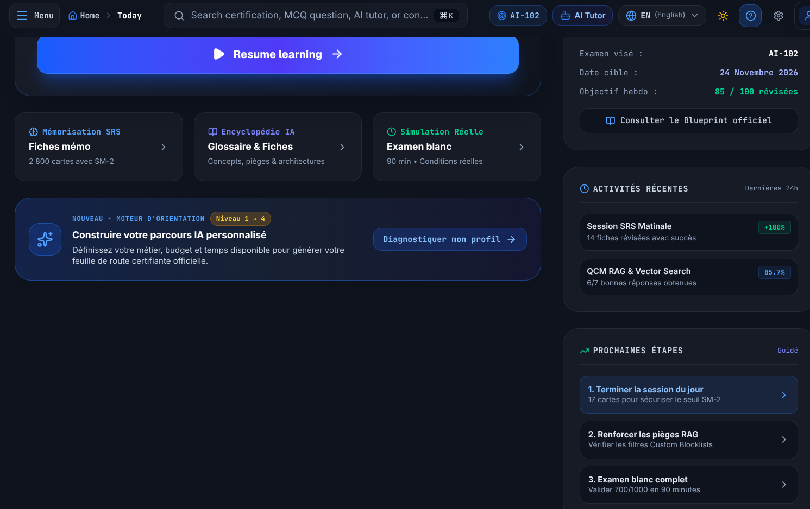
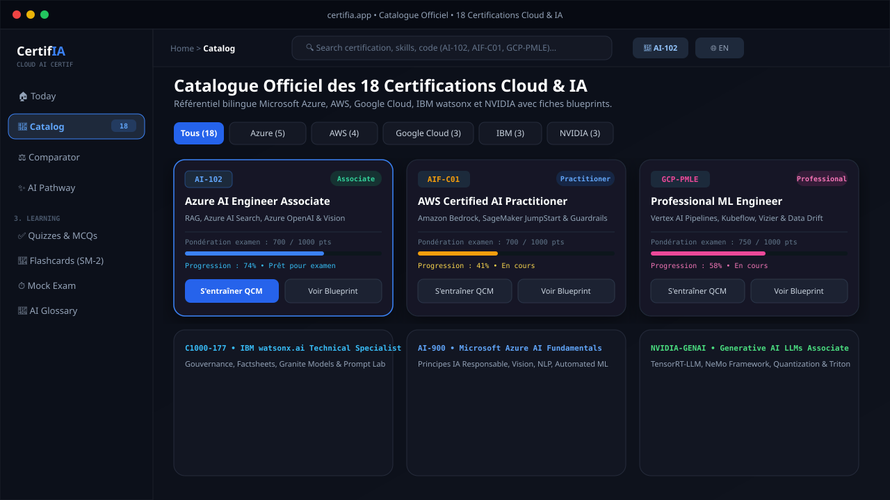
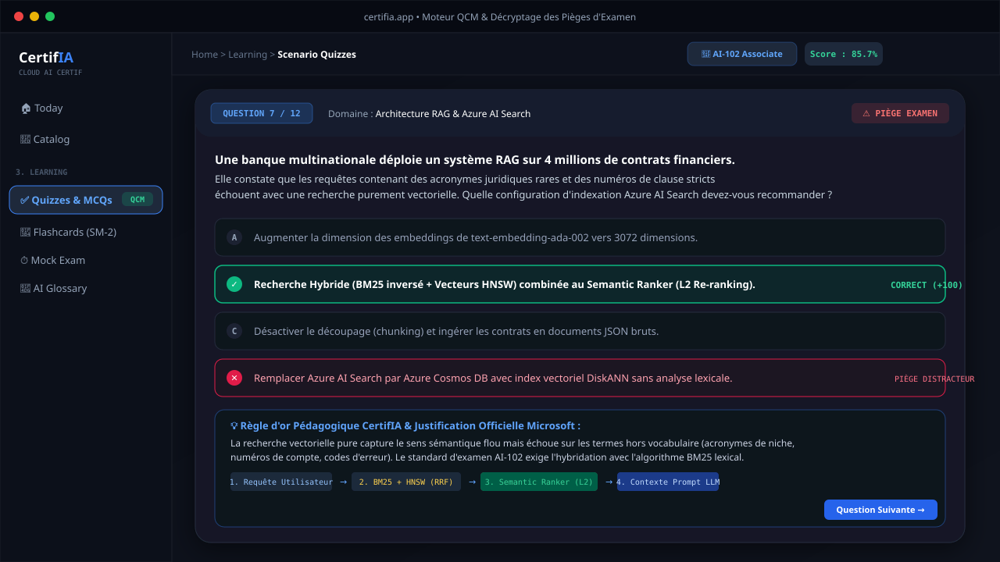
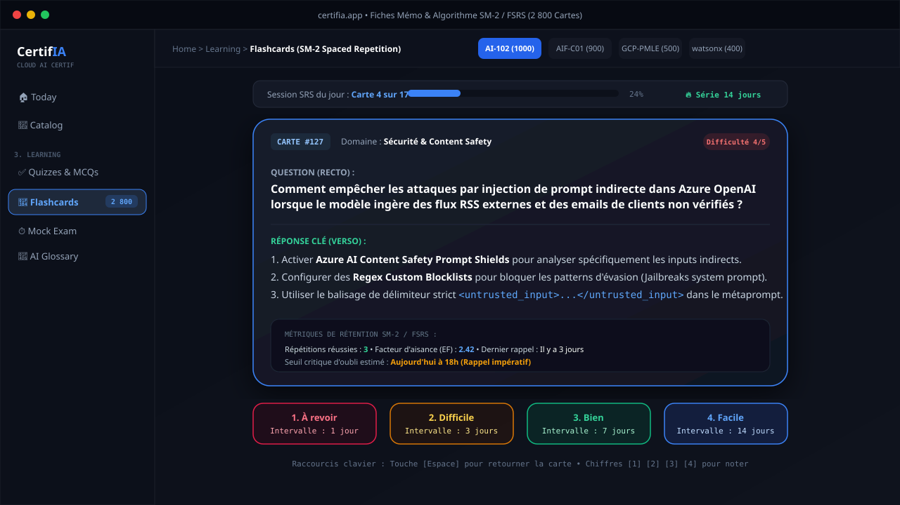
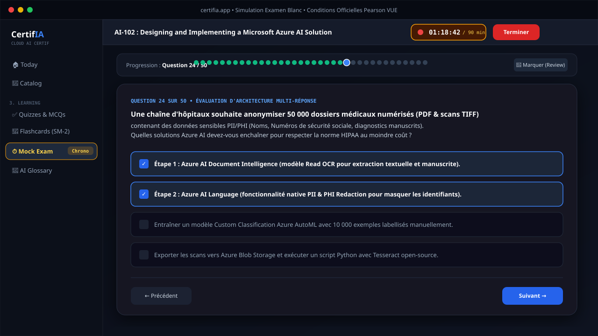
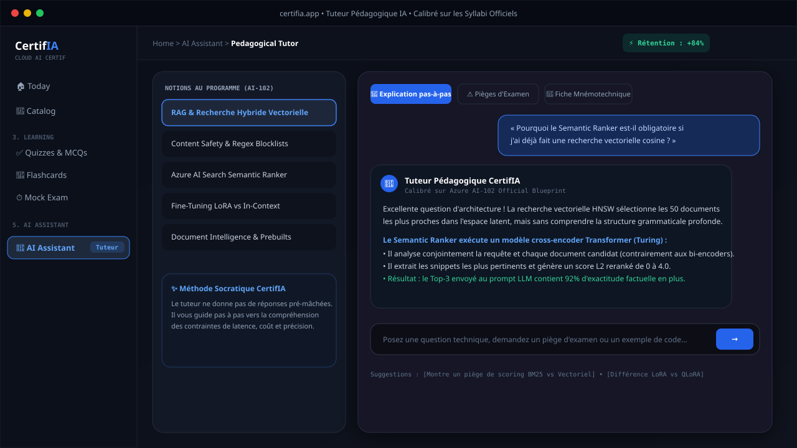
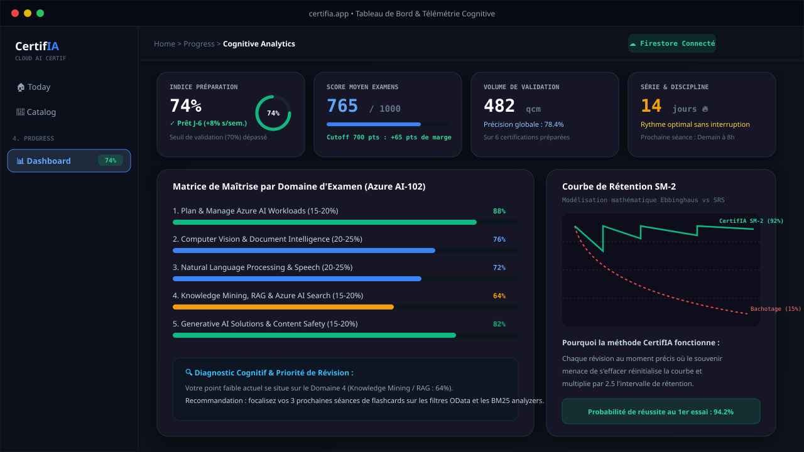
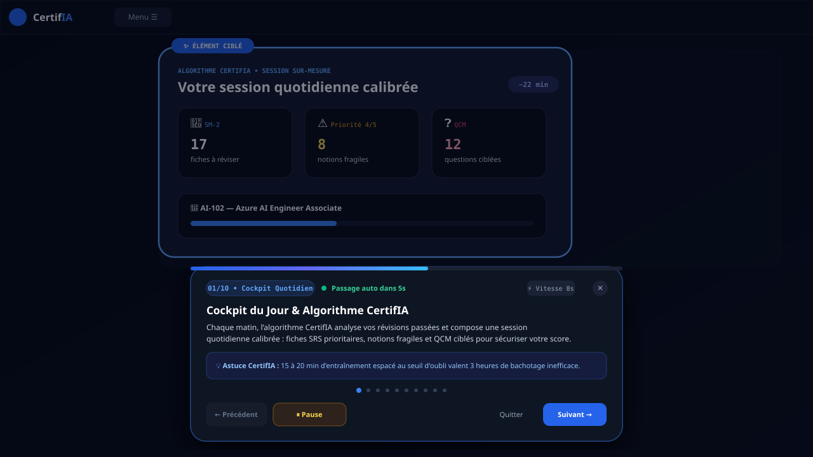

# 🏆 CertifIA • AI Cloud Exam Prep & Cognitive Engine

<div align="center">


### *Plateforme intelligente de préparation certifiante et de télémétrie cognitive pour examens Cloud & IA*
### *Intelligent Certification Prep & Cognitive Telemetry Platform for Cloud & AI Exams*

[](CHANGELOG.md)
[](src/i18n/config.ts)
[](src/i18n/verifyI18nParity.ts)
[](public/manifest.webmanifest)
[](src/lib/srsAlgorithm.ts)
[](src/context/ThemeContext.tsx)
[](src/data/certificationsData.ts)

</div>

---

## 📸 Galerie Complète des Captures d'Écran Réelles de l'Application (v2.7.0)

> **Documentation visuelle actualisée :** Toutes les captures d'écran ci-dessous proviennent fidèlement de l'application réelle en production avec la barre latérale rétractable, l'en-tête dynamique bilingue, le cockpit quotidien, le moteur de parcours, les QCM scénarisés, les flashcards SM-2, les examens blancs et la visite guidée automatique.

---

### 1. 🏠 Cockpit Quotidien & Algorithme CertifIA (Session du Jour)

<div align="center">
  
</div>

* **Session Quotidienne Sur-Mesure (~22 min)** : Chaque matin, l'algorithme CertifIA analyse vos révisions passées pour composer votre session optimale :
  * 🧠 **17 fiches à réviser** au seuil d'oubli calculé par l'algorithme SuperMemo-2 (SM-2) / FSRS.
  * ⚠️ **8 notions fragiles** (pièges à haute pondération identifiés par l'algorithme).
  * ❓ **12 questions QCM d'architecture** non maîtrisées avec mise en situation.
* **Trajectoire Examen 700 pts** : Jauge en temps réel vers le seuil officiel d'admission (700 / 1 000 points) et gain projeté (+3%).
* **Accès Rapide aux 3 Piliers d'Étude** : Mémorisation SRS (2 800 cartes), Encyclopédie IA (Glossaire) et Simulation Réelle (90 min).
* **Détail de Session & Objectif Cible** : Compte à rebours des 37 étapes quotidiennes, date cible d'examen et objectif hebdomadaire synchronisé.

---

### 2. ✨ Moteur d'Orientation & Parcours IA Personnalisé (Niveaux 1 à 4)

<div align="center">
  
</div>

* **Diagnostic Structuré en 4 Paliers** :
  1. *Niveau 1 : Fondamentaux Cloud & IA* (Azure AI-900, AWS AIF-C01).
  2. *Niveau 2 : IA Générative Spécialisée* (AWS Bedrock, IBM watsonx Studio).
  3. *Niveau 3 : Cloud AI Engineer Associate* (Azure AI-102 Associate).
  4. *Niveau 4 : Machine Learning & MLOps Avancé* (Google Cloud PMLE, AWS MLS-C01).
* **Feuille de Route Personnalisée** : Générée selon votre métier (Développeur, Data Scientist, Solution Architect), votre budget et votre temps disponible hebdomadaire.
* **Prochaines Étapes Guidées** : Liste d'actions concrètes numérotées pour sécuriser votre certification sans dispersion.

---

### 3. 🎯 Suivi des Objectifs d'Examen & Activités Récentes

<div align="center">
  
</div>

* **Suivi de l'Examen Visé (AI-102)** : Date cible fixée, objectif de 85 / 100 révisées par semaine, consultation directe du blueprint officiel en un clic.
* **Historique des Activités des Dernières 24h** : Télémétrie en temps réel des sessions matinales SRS (+100%) et des QCM RAG & Vector Search (85.7% de réussite).
* **Prochaines Étapes Priorisées** : Consignes pas-à-pas pour terminer la session du jour, renforcer les pièges RAG (Custom Blocklists) et planifier un examen blanc complet.

---

### 4. 🧭 Catalogue Officiel des 18 Certifications Cloud & IA

<div align="center">
  
</div>

* **Couverture Exhaustive Multi-Fournisseurs** :
  * 🔷 **Microsoft Azure** : AI-102 (Engineer Associate), AI-900 (Fundamentals), DP-100 (Data Scientist), AZ-140, etc.
  * 🟧 **Amazon Web Services (AWS)** : AIF-C01 (AI Practitioner), MLS-C01 (Machine Learning Specialty), Bedrock & SageMaker.
  * 🟥 **Google Cloud Platform (GCP)** : Professional Machine Learning Engineer (PMLE), Cloud AI Associate.
  * 🟦 **IBM** : C1000-177 (watsonx.ai Technical Specialist), watsonx.governance, watsonx.data.
  * 🟩 **NVIDIA** : Generative AI LLMs Associate (TensorRT-LLM, NeMo, Triton Inference Server).
* **Filtres Avancés & Fiches Blueprints** : Recherche instantanée par code, niveau (Fondamental, Associate, Expert) et accès au comparateur côte à côte.

---

### 5. ✅ Moteur d'Entraînement QCM & Analyse des Pièges d'Examen

<div align="center">
  
</div>

* **Mise en Situation Réelle d'Architecture** : Scénarios d'entreprise réalistes (banque, santé, e-commerce, industrie).
* **Décryptage Approfondi des Distracteurs** : Chaque proposition fausse est expliquée en détail pour vous apprendre à déceler les pièges subtils des éditeurs d'examen.
* **Schémas de Flux Techniques (ASCII / Visuels)** : Visualisation du pipeline d'architecture (ex. *Requête ➔ BM25 + HNSW (RRF) ➔ Semantic Ranker L2 ➔ Prompt LLM*).
* **Règle d'or Pédagogique CertifIA** : Synthèse infaillible à mémoriser pour réussir l'examen officiel.

---

### 6. 🎴 Fiches Mémo & Répétition Espacée SM-2 (2 800 Cartes)

<div align="center">
  
</div>

* **Algorithme Scientifique SuperMemo-2 (SM-2) / FSRS** : Calcul automatique du seuil critique d'oubli pour réviser chaque concept au moment mathématique idéal.
* **Échelle d'Évaluation à 4 Boutons** :
  * 🔴 **1. À revoir (1 jour)** : Échec de rappel, le concept est réinjecté sous 24h.
  * 🟠 **2. Difficile (3 jours)** : Rappel laborieux avec hésitation.
  * 🟢 **3. Bien (7 jours)** : Rappel maîtrisé, facteur d'aisance consolidé.
  * 🔵 **4. Facile (14 jours)** : Ancrage profond en mémoire à long terme.
* **Métrique de Rétention Complète** : Facteur d'aisance ($EF$), historique des répétitions et jauge de progression de la file du jour.
* **Contrôle Total au Clavier** : `Espace` pour retourner la carte (Recto/Verso), touches `1`, `2`, `3`, `4` pour noter.

---

### 7. ⏱️ Examens Blancs Chronométrés en Conditions Réelles

<div align="center">
  
</div>

* **Conditions Réelles Pearson VUE** : Chronomètre officiel (90 à 120 minutes), épreuve complète de 50 à 65 questions, seuil éliminatoire officiel (**700 / 1 000 pts**).
* **Carte Interactive d'Avancement** : Grille visuelle de toutes les questions (répondues en vert, en cours en bleu, en attente en gris).
* **Fonctionnalité Marquer (Review Flag)** : Permet de marquer une question difficile pour y revenir avant de soumettre l'épreuve finale.
* **Rapport Final Détaillé** : Décomposition du score par domaine de compétences avec identification précise des lacunes.

---

### 8. 🤖 Tuteur Pédagogique IA Contextuel (Dialogue Socratique)

<div align="center">
  
</div>

* **Approche Socratique d'Apprentissage** : Ne donne jamais la réponse brute sans réflexion : guide l'apprenant à travers les contraintes architecturales de latence, coût et précision.
* **Calibré sur les Syllabi Officiels** : Références précises aux documentations officielles (Microsoft Learn, AWS Docs, GCP Architecture Framework, IBM Cloud).
* **Double Format d'Utilisation** : Disponible sous forme d'écran dédié complet ou de tiroir coulissant contextuel (*Drawer*) accessible depuis n'importe quel QCM.
* **Suggestions de Questions Clés** : Amorces pré-calibrées pour explorer les pièges d'examen (BM25 vs Vectoriel, LoRA vs QLoRA, Private Endpoints).

---

### 9. 📊 Tableau de Bord & Télémétrie Cognitive

<div align="center">
  
</div>

* **4 KPIs Cardinaux de Préparation** :
  * 🎯 **Indice de Préparation Globale (74%)** : Prêt J-6 avec dépassement du seuil de validation.
  * 📈 **Score Moyen aux Examens (765 / 1000)** : Marge de sécurité de +65 points sur le cutoff éliminatoire.
  * 🔢 **Volume Traité (482 questions)** : Précision globale de 78.4% sur toutes certifications.
  * 🔥 **Série & Constance (14 jours)** : Suivi de la régularité sans interruption.
* **Matrice de Maîtrise par Domaine** : Visualisation granulaire des forces et faiblesses pour prioriser les ultimes révisions.
* **Courbe Mathématique de Rétention Ebbinghaus vs SM-2** : Preuve scientifique de l'efficacité du rappel espacé (+84% de rétention vs 15% pour le bachotage passif).

---

### 10. 🧭 Onboarding Tour en Mode Découverte Automatique

<div align="center">
  
</div>

* **Parcours de Découverte 100% Automatique** : Présentation progressive des 10 modules clés de CertifIA sans intervention obligatoire de l'utilisateur.
* **Mise en Évidence Visuelle (Spotlight Cutout)** : Masque d'assombrissement avec anneau lumineux dynamique ciblant avec précision l'élément étudié (`data-tour`).
* **Commandes Explicites Complètes** :
  * ⏸️ **Pause / Continuer** : Fige la progression automatique pour lire attentivement les explications et astuces CertifIA.
  * ◀️ **Précédent** : Revient à l'étape précédente en réinitialisant le délai.
  * ⏹️ **Quitter** (ou touche `Échap`) : Ferme instantanément la visite guidée.
  * ⏭️ **Suivant** : Avance manuellement à l'étape suivante.
* **Régulateur de Vitesse** : Sélecteur de tempo automatique (Rapide 5s, Normal 8s, Détaillé 12s) avec barre de compte à rebours fluide.
* **Navigation Globale au Clavier** : `Espace` (Pause/Continuer), `←` (Précédent), `→` (Suivant), `Échap` (Quitter).

---

## 🌐 Bilinguisme Intégral Français / English (v2.7.0)

CertifIA garantit une expérience utilisateur **100% bilingue sans aucun texte résiduel** :

* 🔄 **Bascule Instantanée Sans Rechargement** : Changez de langue en un clic depuis le Header (`FR` / `EN`), le menu latéral ou le modal système sans perdre votre session active, votre chrono ou votre question en cours.
* 📦 **13 Namespaces i18next Embarqués Hors-Ligne** : `common`, `navigation`, `dashboard`, `certifications`, `learning`, `quizzes`, `flashcards`, `examinations`, `progress`, `assistant`, `settings`, `errors`, `notifications`.
* 🛡️ **Parité Programmatique Stricte 1:1** : Vérification automatisée via script dédié garantissant l'égalité parfaite des 943 clés bilingues :
  ```bash
  npx tsx src/i18n/verifyI18nParity.ts
  # Output: ✅ 943 French keys, 943 English keys across 13 namespaces (0 missing, 0 extra)
  ```
* 🔢 **Formatage Régional Natif `Intl` Conforme** :
  * Dates : `15 mars 2026` (FR) vs `March 15, 2026` (EN).
  * Nombres : `1 250 000` (FR) vs `1,250,000` (EN).
  * Pourcentages : `85 %` (FR) vs `85%` (EN).
  * Devises : `165,00 $US` (FR) vs `$165.00` (EN).

---

## 🏛️ Les 5 Piliers Majeurs de l'Architecture Applicative

| Pilier | Écran Principal | Fonctionnalités Clés |
| :--- | :--- | :--- |
| **1. 🏠 ACCUEIL** | `TodayView.tsx` | Cockpit quotidien, 17 cartes SM-2 dues, 8 notions fragiles, 12 QCM ciblés, bouton reprise immédiate, bannière parcours 4 niveaux. |
| **2. 🧭 CERTIFICATIONS** | `CatalogueView.tsx` | 18 certifications officielles (Azure, AWS, GCP, IBM, NVIDIA), filtres par fournisseur, fiches blueprints, comparateur côte à côte. |
| **3. 🎓 APPRENTISSAGE** | `QuizView.tsx`, `FlashcardsView.tsx`, `ExamView.tsx`, `GlossaryView.tsx` | Hub pédagogique complet : QCM scénarisés, 2 800 fiches mémo SM-2, examens chronométrés 90 min, encyclopédie IA A-Z. |
| **4. 📊 PROGRESSION** | `AnalyticsView.tsx` | Télémétrie cognitive, matrice de maîtrise des domaines, courbe de rétention d'Ebbinghaus, historique des tentatives. |
| **5. 🤖 ASSISTANT IA** | `AIAssistantView.tsx`, `AIAssistantDrawer.tsx` | Tuteur pédagogique socratique contextuel, explication pas-à-pas des architectures cloud, pièges d'examen officiels. |

---

## ⌨️ Raccourcis Clavier Globaux

| Raccourci | Action |
| :--- | :--- |
| `Ctrl + K` / `Cmd + K` | Ouvrir la **Command Palette** (recherche globale et actions rapides) |
| `Ctrl + M` / `Cmd + M` | Ouvrir / Fermer le **Menu Hamburger Catégorisé** |
| `Espace` | Retourner la carte mémo active (Recto / Verso) • Mettre en pause ou continuer le Tour |
| `1` / `2` / `3` / `4` | Noter la carte active (*À revoir [1j]*, *Difficile [3j]*, *Bien [7j]*, *Facile [14j]*) |
| `←` / `→` | Naviguer entre les étapes du Onboarding Tour |
| `Échap` | Fermer n'importe quel panneau, tiroir, modal ou quitter la visite guidée |

---

## 🛠️ Stack Technique & Déploiement

* **Framework :** React 19 + TypeScript (Mode Strict)
* **Build Tool :** Vite 8
* **Styling :** Tailwind CSS v4 (Mode Sombre et Mode Clair)
* **Internationalisation :** i18next + react-i18next (13 namespaces, 943 clés 1:1)
* **Persistance & Données :** Cloud Firestore + LocalStorage haute fidélité
* **PWA & Offline :** Web App Manifest (`manifest.webmanifest`) + Service Worker autonome (`/sw.js`)
* **Icônes :** Lucide React

```bash
# Installation des dépendances
npm install

# Lancement en développement (Port 3000)
npm run dev

# Vérification de la parité bilingue
npx tsx src/i18n/verifyI18nParity.ts

# Compilation et vérification TypeScript
npm run build
```

---

## ⚖️ Mentions Légales & Avertissement

> **Clause d'exonération de responsabilité :**  
> L'éditeur et les créateurs de **CertifIA** déclinent formellement toute responsabilité quant à l'exactitude, l'exhaustivité, l'actualité ou la conformité des données, questions, propositions de réponses, explications ou synthèses fournies dans l'application. CertifIA est un projet indépendant d'entraînement cognitif personnel et n'est affilié à aucun des organismes certificateurs mentionnés (Microsoft, AWS, Google Cloud, IBM, NVIDIA).
